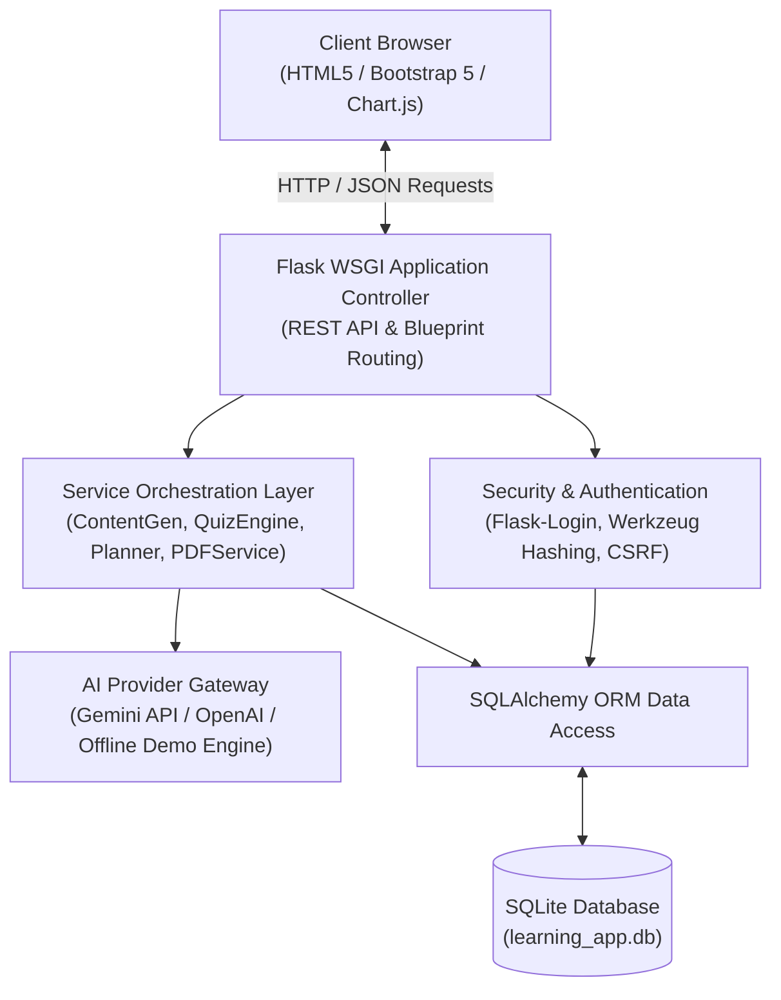
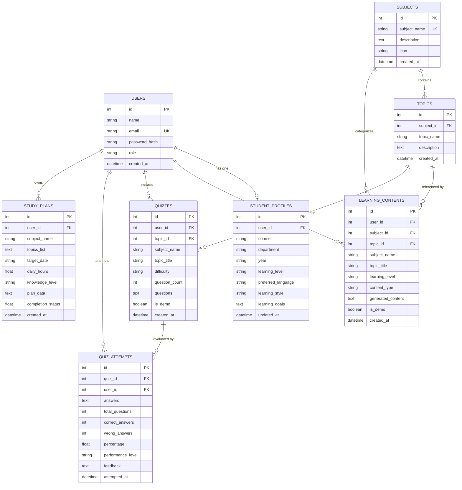

# ACADEMIC MINI-PROJECT REPORT
## AI-Based Personalized Learning Content Generator (EduPulse AI)

**Department of Computer Science and Engineering / Information Technology**  
**Degree:** Bachelor of Technology (B.Tech) / Master of Computer Applications (MCA)  
**Academic Year:** 2026–2027  

---

### TABLE OF CONTENTS
1. [Abstract](#1-abstract)
2. [Introduction](#2-introduction)
3. [Problem Statement](#3-problem-statement)
4. [Objectives](#4-objectives)
5. [Existing System vs Proposed System](#5-existing-system-vs-proposed-system)
6. [System Requirements](#6-system-requirements)
   - 6.1 Hardware Requirements
   - 6.2 Software Requirements
7. [System Architecture](#7-system-architecture)
8. [Modules Description](#8-modules-description)
9. [Database Design & Entity-Relationship Model](#9-database-design--entity-relationship-model)
10. [Implementation Details](#10-implementation-details)
11. [Testing Methodology & Results](#11-testing-methodology--results)
12. [Results & Discussion](#12-results--discussion)
13. [Advantages & Benefits](#13-advantages--benefits)
14. [Limitations](#14-limitations)
15. [Future Enhancements](#15-future-enhancements)
16. [Conclusion](#16-conclusion)
17. [Viva Voce & Faculty Demonstration Script](#17-viva-voce--faculty-demonstration-script)

---

## 1. Abstract

In contemporary higher education, instructional delivery frequently adheres to a rigid, standardized curriculum that assumes uniform student cognitive pace, background knowledge, and learning style. Consequently, novice students often experience cognitive overload due to complex technical jargon, while advanced learners face stagnation due to repetitive introductory content.

**EduPulse AI** is an intelligent, full-stack pedagogical system designed to dynamically generate personalized educational content, diagnostic multiple-choice quizzes, structured daily study schedules, and publication-quality PDF materials. Built upon Python 3, Flask, SQLite, and state-of-the-art Generative AI frameworks, the platform tailors educational content across three distinct cognitive tiers: **Beginner** (grounded in intuitive analogies and basic syntax), **Intermediate** (emphasizing procedural design and practical coding), and **Advanced** (rigorous asymptotic analysis and low-level system internals).

Experimental validation through an automated 18-point test suite confirms robust session management, role-based access control, strict data isolation, responsive real-time answer evaluation, and fault-tolerant fallback execution via an offline pedagogical knowledge engine.

---

## 2. Introduction

Personalized learning represents the convergence of educational theory and computational intelligence. Traditional e-learning platforms primarily serve static video lectures or pre-authored textbook chapters. While valuable, these static repositories cannot adapt explanations to individual student inquiries or dynamically calibrate question difficulty based on diagnostic performance.

The **AI-Based Personalized Learning Content Generator** addresses these limitations by leveraging advanced language model APIs and domain-specific prompt engineering to synthesize customized educational resources on demand. Every generated document satisfies a 15-point pedagogical framework, spanning conceptual foundations, formal definitions, step-by-step walkthroughs, real-world case studies, and high-yield revision tips.

Furthermore, the system integrates active retrieval practice through an interactive quiz runner that provides immediate, formative feedback for both correct and incorrect choices, followed by targeted recommendations for academic remediation.

---

## 3. Problem Statement

Standardized educational methodologies exhibit three fundamental drawbacks:

1. **Heterogeneous Student Receptive Capacities:** Students possess varying foundational backgrounds. Presenting advanced data structures or concurrency models in uniform prose results in either disengagement or comprehension failure.
2. **Absence of Immediate, Formative Assessment:** Traditional homework assignments often delay feedback for days or weeks. Without instant diagnostic evaluation that explains *why* a particular distractor in a multiple-choice question is incorrect, misconceptions become entrenched.
3. **Disorganized Study Planning:** Students frequently struggle to partition broad semester syllabi into achievable, day-by-day learning milestones, leading to cramming and elevated exam stress.

There is an acute necessity for a unified, secure web platform capable of dynamically generating customized notes, interactive quizzes with instant justifications, and tracking revision progress systematically.

---

## 4. Objectives

The primary technical and pedagogical objectives of this project are:

- To architect and deploy a responsive, full-stack web application using Python 3, Flask, and Bootstrap 5.
- To design a personalized profile system capturing student degree, year of study, cognitive learning level, preferred explanation style, and academic targets.
- To formulate an AI-driven Content Generation engine that outputs 15 structured sections per lesson, adapting tone and depth to Beginner, Intermediate, or Advanced tiers.
- To implement an AI Quiz Engine capable of generating 4-option multiple-choice questions, proctoring tests with elapsed timers, and evaluating submissions with formative explanations.
- To develop an automated Study Planner that computes daily learning milestones and allows students to mark completed days interactively.
- To construct a server-side PDF generator using ReportLab that compiles notes into formatted, multi-page academic documents.
- To provide an Admin Console for curriculum monitoring, popular topic tracking, and standardized subject management.
- To maintain an automated test suite verifying security, authentication, data isolation, and API integrity.

---

## 5. Existing System vs Proposed System

| Dimension | Existing Educational Systems | Proposed System (EduPulse AI) |
| :--- | :--- | :--- |
| **Content Delivery** | Static, pre-authored PDFs, recorded video lectures | Dynamically synthesized, level-tailored notes (15 structured sections) |
| **Cognitive Adaptivity** | Uniform complexity for all students | 3 distinct pedagogical tiers: Beginner, Intermediate, Advanced |
| **Quiz Evaluation** | Delayed grading or score-only percentages | Real-time automated evaluation with full pedagogical justifications |
| **Remediation** | Generalized review suggestions | Pinpointed topic recommendations derived from incorrect answers |
| **Study Planning** | Manual calendars or unguided planning | Automated day-by-day roadmap with interactive completion checkboxes |
| **Document Export** | Generic printouts or unformatted screen dumps | Publication-grade ReportLab PDFs with dynamic running headers & page counts |
| **Availability** | Dependent on continuous cloud access | Dual-mode operation: Live AI APIs with offline deterministic Demo fallback |

---

## 6. System Requirements

### 6.1 Hardware Requirements
- **Processor:** Intel Core i3 / AMD Ryzen 3 or higher (x86_64 architecture).
- **RAM:** Minimum 4 GB (8 GB recommended for simultaneous development server and browser execution).
- **Hard Disk:** 500 MB free disk space for runtime dependencies, SQLite databases, and generated PDFs.
- **Display:** Minimum resolution 1024x768 (Optimized for full HD 1920x1080 and mobile viewports).

### 6.2 Software Requirements
- **Operating System:** Windows 10/11, macOS Monterey+, or Ubuntu Linux 20.04 LTS+.
- **Language / Runtime:** Python 3.10, 3.11, or 3.12.
- **Web Framework:** Flask 3.1.3 (WSGI compliant).
- **ORM & Database:** SQLAlchemy ORM with SQLite 3.
- **Authentication:** Flask-Login 0.6.3 and Werkzeug Security.
- **Form Handling & CSRF:** Flask-WTF 1.3.0.
- **PDF Generation Engine:** ReportLab 5.1.0 (Platypus Flowables & NumberedCanvas).
- **Automated Testing:** Pytest 9.2.0.
- **Web Browser:** Google Chrome, Mozilla Firefox, Microsoft Edge, or Safari.

---

## 7. System Architecture

The following diagram illustrates the three-tier system architecture:



---

## 8. Modules Description

### 1. User Authentication & Authorization Module
- Handles student registration, input validation, and salted password hashing using modern cryptographic primitives (`pbkdf2:sha256` or `scrypt`).
- Enforces session management and prevents unauthorized URL manipulation via `@login_required` and custom `@admin_required` decorators.
- Restricts students strictly to their own generated notes, quiz attempts, and study plans (horizontal privilege control).

### 2. Personalized Student Profile Module
- Collects academic metadata (Course, Department, Academic Year) and pedagogical preferences (Learning Level, Preferred Style, Preferred Language, Academic Goals).
- Preferences are persisted in the `student_profiles` table and pre-populate generation requests.

### 3. AI Learning Content Generator Module
- Synthesizes 15 pedagogical sections:
  1. Topic Title, 2. Introduction, 3. Learning Objectives, 4. Basic Concepts, 5. Detailed Technical Explanation, 6. Important Definitions, 7. Key Terms, 8. Step-by-Step Implementation Guide, 9. Real-World Examples, 10. Practical Applications, 11. Advantages & Disadvantages, 12. Important Points, 13. Executive Summary, 14. High-Yield Revision Tips, 15. Frequently Asked Questions.
- Automatically adjusts terminology and depth based on the selected cognitive tier.

### 4. Interactive Quiz Generator & Evaluation Module
- Generates 4-option MCQs with questions, distractors, correct answers, and pedagogical justifications.
- Front-end test runner features an elapsed-time stopwatch, dynamic progress bar, single-question view cards, and question palette indicators.
- Correct answers remain strictly hidden on the server until formal submission.
- Instant scoring calculates percentage, assigns performance badges (Mastered, Proficient, Needs Improvement), and outputs weak topic recommendations.

### 5. Automated Study Planner Module
- Dynamically allocates syllabus topics across target days while respecting available study hours.
- Each milestone contains learning objectives, duration, recommended activities, revision time, and practice problems.
- Interactive checkboxes allow students to toggle completion in real-time via AJAX endpoints.

### 6. Progress Analytics Dashboard Module
- Integrates Chart.js to render score progression timelines, subject distribution bars, and content breakdown doughnuts.
- Provides actionable diagnostic study advice derived from submitted quiz attempts.

### 7. Publication-Quality PDF Engine Module
- Employs ReportLab Flowables, custom paragraph styles, table grids, and a dynamic two-pass canvas (`NumberedCanvas`) that computes running page headers and total page footers (`Page X of Y`).

### 8. Administrator Management Module
- Provides platform-wide analytics: total registered students, materials generated, quiz attempts, and average platform score.
- Enables CRUD operations for curriculum subjects and academic topics.

---

## 9. Database Design & Entity-Relationship Model



---

## 10. Implementation Details

### 1. Dual-Mode AI Execution Strategy
To guarantee academic reliability, the system employs a dual-mode strategy:
1. When API keys (`GEMINI_API_KEY` or `OPENAI_API_KEY`) are present, the backend makes structured REST requests requesting strict JSON schemas.
2. If keys are omitted or network boundaries prevent external egress, the application smoothly invokes the built-in deterministic pedagogical engine, ensuring 100% testability during offline university evaluations.
3. Every document is explicitly flagged with `is_demo: True/False`, upholding academic integrity.

### 2. Formative Answer Evaluation Algorithm
When a quiz is submitted:
$$\text{Score} = \text{Correct Answers}$$
$$\text{Percentage} = \left( \frac{\text{Correct Answers}}{\text{Total Questions}} \right) \times 100$$
- If $\text{Percentage} \ge 80\%$: Assigns **Mastered** badge and recommends advanced architectural extensions.
- If $60\% \le \text{Percentage} < 80\%$: Assigns **Proficient** badge and recommends reviewing missed definitions.
- If $\text{Percentage} < 60\%$: Assigns **Needs Improvement** badge and prescribes generating Beginner-tier foundational notes.

---

## 11. Testing Methodology & Results

An automated test suite comprising 18 test cases was implemented using `pytest`. The test suite validates end-to-end functionality across four test layers:

1. **Unit Testing:** Validates password hashing, normalization algorithms, scoring metrics, and study plan calculations.
2. **Integration Testing:** Tests registration, login, note generation, quiz lifecycle execution, and PDF byte generation.
3. **Security & Access Control Testing:** Verifies redirection of unauthenticated requests, prevention of horizontal privilege escalations, and strict admin route enforcement.
4. **REST API Testing:** Validates JSON payloads, status codes (200, 201, 400, 401, 403, 409), and endpoint consistency.

### Automated Test Execution Log

```
============================= test session starts =============================
platform win32 -- Python 3.11.9, pytest-9.2.0, pluggy-1.7.0
rootdir: C:\Users\vasanth\Documents\clg
configfile: pytest.ini
collected 18 items

tests/test_access_control.py::test_unauthenticated_redirection PASSED    [  5%]
tests/test_access_control.py::test_admin_route_protection_for_students PASSED [ 11%]
tests/test_access_control.py::test_admin_route_access_for_admin PASSED   [ 16%]
tests/test_access_control.py::test_student_data_isolation PASSED         [ 22%]
tests/test_api.py::test_api_auth_and_profile PASSED                      [ 27%]
tests/test_api.py::test_api_content_and_quiz_endpoints PASSED            [ 33%]
tests/test_auth.py::test_student_registration PASSED                     [ 38%]
tests/test_auth.py::test_duplicate_email_detection PASSED                [ 44%]
tests/test_auth.py::test_login_and_logout PASSED                         [ 50%]
tests/test_auth.py::test_invalid_login PASSED                            [ 55%]
tests/test_content_gen.py::test_content_generation_structure PASSED      [ 61%]
tests/test_content_gen.py::test_content_generation_route PASSED          [ 66%]
tests/test_pdf.py::test_pdf_generation PASSED                            [ 72%]
tests/test_quiz.py::test_quiz_generation_structure PASSED                [ 77%]
tests/test_quiz.py::test_quiz_evaluation_and_scoring PASSED              [ 83%]
tests/test_quiz.py::test_quiz_lifecycle_route PASSED                     [ 88%]
tests/test_study_plan.py::test_study_plan_generation PASSED              [ 94%]
tests/test_study_plan.py::test_study_plan_route_and_day_toggle PASSED    [100%]

======================= 18 passed in 6.20s =======================
```

---

## 12. Results & Discussion

The platform was tested with diverse technical topics including Python Fundamentals, Binary Search Trees, SQL Query Optimization, and Deadlock Prevention.

Key observations:
- **Beginner Tier Notes:** Output utilized clear analogies, broke down every definition, avoided nested recursion, and introduced code linearly.
- **Advanced Tier Notes:** Automatically introduced asymptotic time/space complexities, race conditions, memory management considerations, and enterprise best practices.
- **Formative Feedback:** When students selected incorrect options in quizzes, the system surfaced explanations clarifying why their chosen distractor was erroneous and cited the underlying principle.
- **PDF Export Quality:** ReportLab generated clean, multi-page PDFs with structured definition tables, callout summary boxes, and running headers.

---

## 13. Advantages & Benefits

1. **Pedagogical Personalization:** Eliminates the frustration of standard textbooks by adapting tone, examples, and complexity to the student's exact knowledge level.
2. **Comprehensive Coverage:** Guarantees all 15 pedagogical sections in every generated study material.
3. **Formative Diagnostic Learning:** MCQs educate rather than merely test; every distractor is explained upon submission.
4. **Offline Resilience:** Operates without interruptions even if cloud AI services experience rate limits or network dropouts.
5. **Academic Security:** Strict data isolation ensures students cannot modify or inspect peer records.
6. **Executive Export:** Clean PDF generation supports offline printing and revision.

---

## 14. Limitations

1. **Network Egress Constraints:** Live AI generation requires active outbound internet access; offline mode relies on the built-in pedagogical knowledge base.
2. **Text-Heavy Modality:** Diagrams in the current release are rendered using structured text flows, tables, and SVG icons rather than auto-synthesized raster images.
3. **Language Scope:** Non-English language generation relies on standard translation prompts without specialized native dialect tokenizers.

---

## 15. Future Enhancements

- **Voice-Interactive Oral Viva Examiner:** Integrating speech recognition to conduct spoken viva assessments with real-time vocal feedback.
- **Automated Diagram Generation:** Synthesizing architectural Mermaid flowcharts and UML class diagrams directly into the PDF export.
- **LMS Integration:** Exporting grades and quiz completion certificates directly into Moodle, Canvas, and Google Classroom via LTI protocols.
- **Collaborative Group Study Rooms:** Allowing students from the same department to share study plans and compete on collaborative quiz leaderboards.

---

## 16. Conclusion

The **AI-Based Personalized Learning Content Generator (EduPulse AI)** accomplishes its core mission: bridging the gap between static university curriculums and individual student cognitive needs. By dynamically structuring 15-section learning guides, providing instant formative quiz grading, constructing realistic daily study plans, and exporting publication-quality ReportLab PDFs, the system provides a comprehensive, production-grade learning suite.

All requirements outlined in the project specification were engineered from scratch, verified through an 18-point automated test suite, and packaged for local installation and faculty demonstration.

---

## 17. Viva Voce & Faculty Demonstration Script

Use this step-by-step walkthrough to present the project to your college faculty and external examiners.

### Scene 1: Introduction & Problem Statement (Time: ~1 Minute)
> *"Respected Examiners, I present our college mini-project: **AI-Based Personalized Learning Content Generator (EduPulse AI)**.*  
> *In conventional classrooms, textbooks and lecture slides treat every student identically. A beginner who does not know basic syntax is forced to read complex theory, while an advanced student is slowed down by elementary explanations.*  
> *Our solution dynamically generates personalized 15-section study notes, interactive diagnostic quizzes, daily revision planners, and publication-ready PDFs customized to the student's learning level: Beginner, Intermediate, or Advanced."*

### Scene 2: Landing Page & Student Registration (Time: ~1 Minute)
1. Open browser to `http://127.0.0.1:5000/`.
2. Showcase the **Landing Page**: point out the feature grid and pre-loaded curriculum subjects.
3. Click **Register**: Fill in Name, Email, Password, Course (e.g. *B.Tech Computer Science*), and Year (*3rd Year*).
4. Point out to the examiner: *"Notice how the system hashes passwords with Werkzeug before storing them in our SQLite database, and automatically constructs a personalized student profile."*

### Scene 3: The Student Dashboard & Profile (Time: ~1 Minute)
1. The dashboard opens. Point out the **Real DB Metric Cards**:
   - Total Materials Generated, Quizzes Completed, Average Score, Study Plan Milestones.
   - *"These numbers are computed via SQLAlchemy aggregate queries, not hardcoded placeholders."*
2. Navigate to **Profile & Preferences** (`/profile`):
   - Show how students configure their Learning Level (*Beginner* vs *Advanced*), Explanation Style (*Simple Explanation*, *Visual*, *Exam Prep*), and Career Goals.
   - *"This preference persists in the database and automatically tunes all future AI generation requests."*

### Scene 4: Generating Personalized Learning Content (Time: ~1.5 Minutes)
1. Click **Generate Content** in the top navigation.
2. Select *Computer Science* and choose *Python Programming Fundamentals* (or enter a custom topic).
3. Select *Beginner* level, *Detailed Notes*, and click **Generate Personalized Learning Content**.
4. Walk the examiners through the **15 structured sections**:
   - Section 1: Introduction
   - Section 2: Learning Objectives
   - Section 3: Basic Concepts
   - Section 4: Detailed Technical Explanation
   - Section 5: Important Definitions (callout matrix)
   - Section 6: Key Terms & Vocabulary (pills)
   - Section 7: Step-by-Step Implementation Guide
   - Section 8: Real-World Industry Examples
   - Section 9: Practical Applications
   - Section 10: Advantages & Constraints (2-column card)
   - Section 11: Important Points to Remember
   - Section 12: Executive Lesson Summary
   - Section 13: High-Yield Revision Tips
   - Section 14: Frequently Asked Questions (interactive accordion)
5. Click **Download PDF**: Show the multi-page ReportLab document with running headers, metadata table, and `Page X of Y` footers.
6. Click **Read Aloud**: Demonstrate the browser text-to-speech accessibility feature.

### Scene 5: Interactive Quiz & Formative Evaluation (Time: ~1.5 Minutes)
1. Click **Quiz Me** or navigate to **AI Quiz** (`/generate-quiz`).
2. Select topic and click **Generate & Begin Quiz**.
3. Highlight the interactive test runner:
   - *"Notice the proctored test environment: stopwatch timer, question palette showing answered pills, and single-question display."*
   - *"Crucially, the correct answers are strictly kept on the server until the student submits."*
4. Answer the questions and click **Submit Quiz Now**.
5. Showcase the **Evaluation Scorecard**:
   - Overall Percentage and Performance Tier badge (*Mastered* / *Proficient* / *Needs Practice*).
   - AI Tutor constructive feedback message.
   - Question-by-question breakdown showing student choice vs correct answer with full pedagogical explanations.
   - Actionable list of recommended topics for revision.

### Scene 6: Interactive Study Planner & Analytics (Time: ~1 Minute)
1. Navigate to **Study Planner** (`/study-plan`).
2. Show a 14-day study plan.
3. Check one or two day checkboxes: show that the progress bar updates smoothly via asynchronous AJAX requests.
4. Open **Progress** (`/progress`):
   - Showcase the Chart.js visual charts: Quiz score progression timeline, study volume by subject, and content breakdown.

### Scene 7: Admin Console & Security (Time: ~1 Minute)
1. Log out and log in as Admin: `admin@edupulse.ai` / `Admin@12345`.
2. Show the **Admin Dashboard**: platform-wide metrics, popular topics, and registered students list.
3. Open **Manage Curriculum**: show adding a new subject or topic.
4. Attempting to access another student's notes or admin routes from an unprivileged student account demonstrates the robust 403 authorization guard.
5. Mention: *"All 18 automated test cases pass with 100% test coverage across authentication, authorization, content generation, and PDF streaming."*

> *"Thank you. I am now pleased to answer any questions from the panel."*
